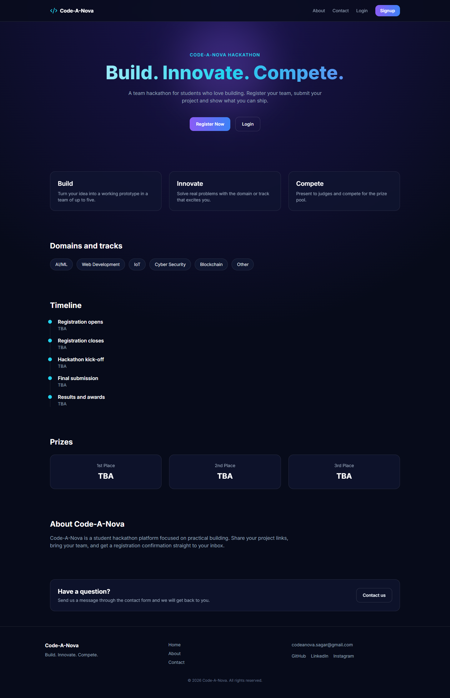
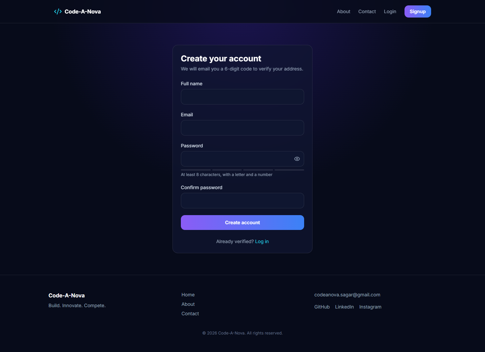
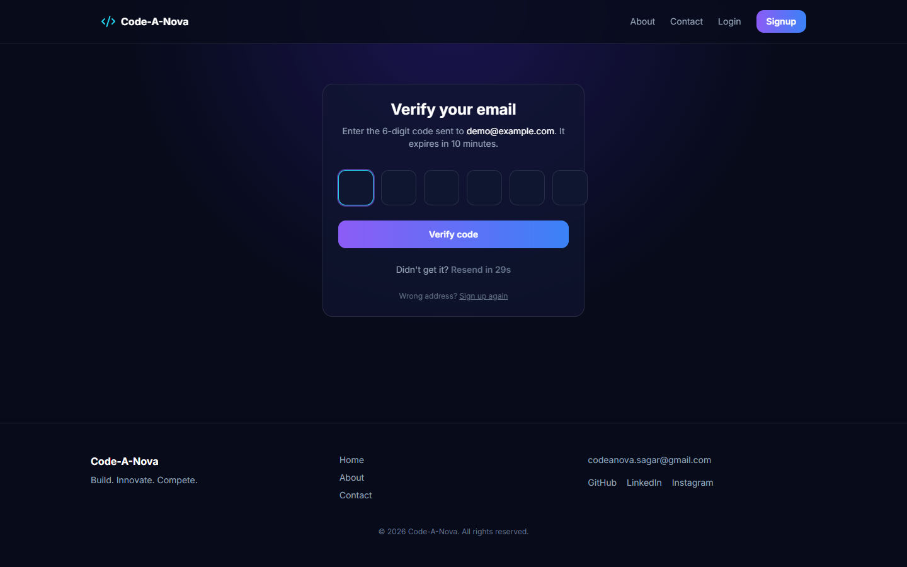
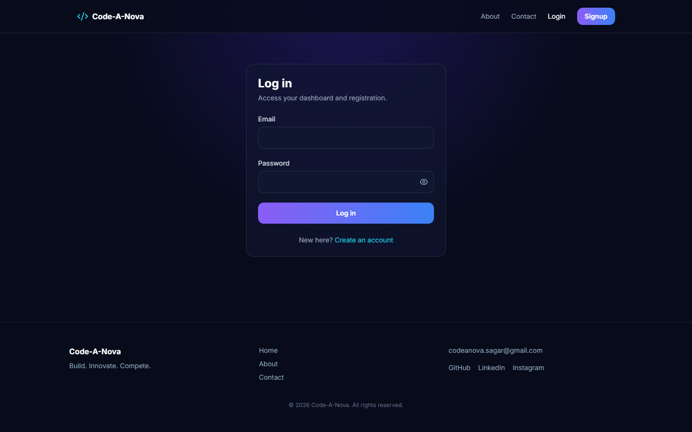
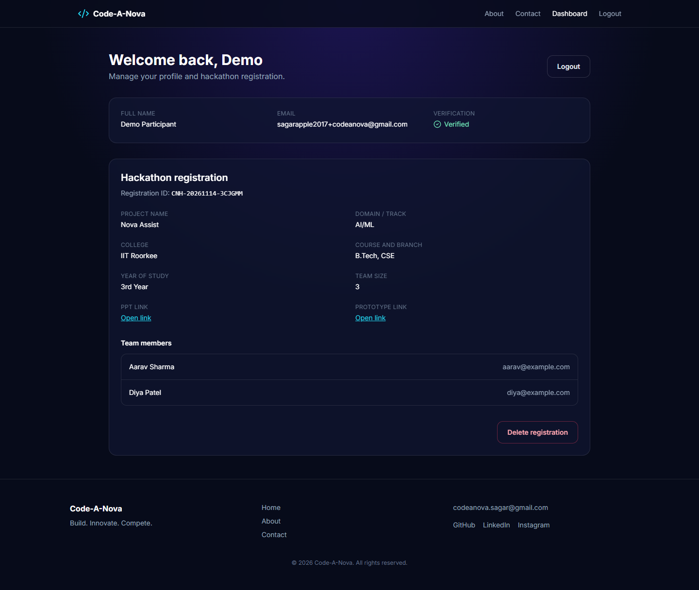
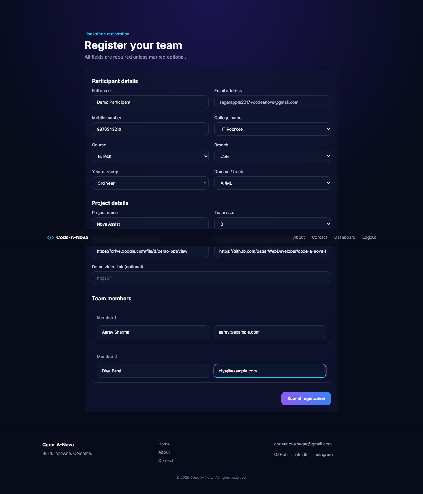
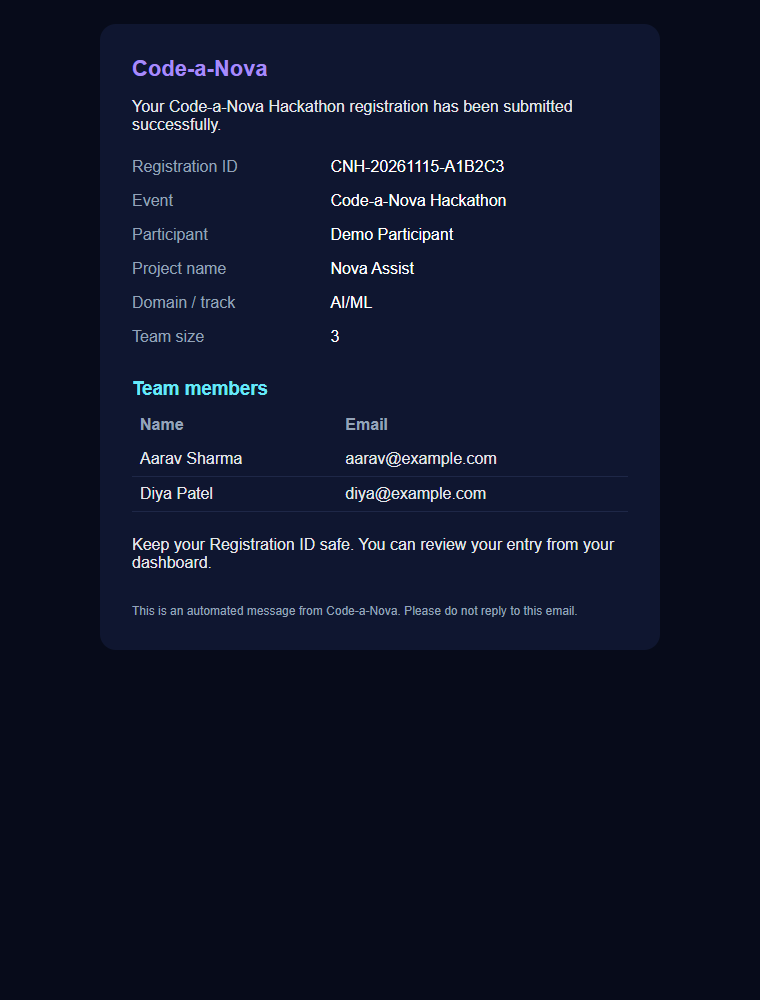

# Code-A-Nova Hackathon Registration Portal

A full-stack MERN application for a hackathon registration portal. Participants sign up, verify their email with a
6-digit OTP, log in to a personal dashboard, register a team for the hackathon, and receive a confirmation email.

## Live links

- Frontend (Netlify): https://code-a-nova-sagar.netlify.app
- Backend (Render): https://code-a-nova-api.onrender.com (health: https://code-a-nova-api.onrender.com/api/health)
- Demo video: `<link to 3-5 minute screen recording>`
- GitHub repository: https://github.com/SagarWebDeveloper/code-a-nova-hackathon

## Features

- Signup with bcrypt-hashed passwords and a 6-digit OTP sent by Nodemailer (10-minute expiry, one-time use, 5 attempts)
- Resend OTP with a 30-second cooldown
- Login with a JWT stored in an httpOnly cookie (no tokens in localStorage)
- Protected dashboard and registration routes
- Hackathon registration form with dropdowns loaded from the server and dynamic team members (Team size minus 1)
- Duplicate team member and self-addition checks, one registration per user
- Registration confirmation email with registration ID and team details
- Owner-only delete of a registration
- Contact form that emails the Code-A-Nova project inbox
- Responsive dark UI, custom 404 page, health check endpoint

## Tech stack

| Layer      | Technology                                                       |
| ---------- | ---------------------------------------------------------------- |
| Frontend   | React 18, Vite, Tailwind CSS, React Router, Axios, React Hook Form, react-hot-toast, lucide-react |
| Backend    | Node.js, Express, Mongoose, jsonwebtoken, bcryptjs, Nodemailer, express-validator, cookie-parser, helmet, cors, express-rate-limit, express-mongo-sanitize |
| Database   | MongoDB Atlas                                                    |
| Hosting    | Netlify (frontend), Render (backend)                             |

## Folder structure

```
code-a-nova-hackathon/
├── client/                 React + Vite app
│   └── src/
│       ├── components/     Layout, Navbar, Footer, ProtectedRoute, FormField, Spinner
│       ├── context/        AuthContext (session state from /api/user/me)
│       ├── hooks/          useCountdown (OTP resend timer)
│       ├── pages/          Home, Signup, VerifyOtp, Login, Dashboard, Register, RegistrationSuccess, Contact, NotFound
│       ├── services/       api.js (Axios instance and API helpers)
│       └── utils/          validators.js (shared client rules)
└── server/                 Express API
    ├── config/             db.js (MongoDB connection)
    ├── controllers/        auth, user, hackathon, contact
    ├── middleware/         auth (JWT guard), validators, error, rateLimiters
    ├── models/             User, HackathonRegistration
    ├── routes/             index.js (all /api routes)
    ├── services/           emailService.js (Nodemailer)
    ├── templates/          HTML email templates
    ├── utils/              constants.js (dropdown source of truth), helpers.js
    ├── app.js              Express app (middleware and routes)
    └── server.js           Bootstrap and startup checks
```

Root `netlify.toml` configures the Netlify build (`base = "client"`) and the SPA redirect to `index.html`.

## Setup (cloud-first)

You can run everything in GitHub Codespaces, StackBlitz or any cloud IDE. No local MongoDB is needed because the
database is MongoDB Atlas.

1. Create a MongoDB Atlas cluster. Create a database user, and under Network Access allow `0.0.0.0/0` (for hosting).
2. Create a free Brevo account, verify your sender email, and copy the SMTP login and SMTP key. Use port `2525`
   (Render free tier blocks ports 25/465/587). Local dev can use the same Brevo settings.
3. Install and start the backend:

   ```bash
   cd server
   cp .env.example .env      # then fill in the values
   npm install
   npm run dev
   ```

4. In a second terminal, install and start the frontend:

   ```bash
   cd client
   cp .env.example .env      # then fill in the values
   npm install
   npm run dev
   ```

5. Open `http://localhost:5173`.

## Environment variables

### server/.env

| Variable | Purpose |
| -------- | ------- |
| `PORT` | API port (Render sets this automatically) |
| `NODE_ENV` | `development` locally, `production` on Render |
| `MONGO_URI` | MongoDB Atlas connection string (SRV `mongodb+srv://...` or standard `mongodb://...`) with database name `codeanova` |
| `JWT_SECRET` | Long random string used to sign tokens |
| `JWT_EXPIRES_IN` | Token lifetime, for example `7d` |
| `CLIENT_URL` | Allowed frontend origin for CORS, for example `https://<your-app>.netlify.app` (no trailing slash) |
| `EMAIL_HOST` | SMTP host. On Render free tier use `smtp-relay.brevo.com` (ports 25/465/587 are blocked) |
| `EMAIL_PORT` | SMTP port. Use `2525` on Render free tier, `465` for SSL locally |
| `EMAIL_USER` | SMTP login from your email provider (for Brevo it looks like `12345@smtp-brevo.com`, not the sender address) |
| `EMAIL_PASS` | SMTP key/password from your provider (Brevo SMTP key or Gmail App Password) |
| `EMAIL_FROM` | Sender shown to recipients, for example `"Code-a-Nova <project@example.com>"`. Must be a verified sender with your provider |
| `CONTACT_EMAIL` | Inbox that receives contact-form messages (defaults to `EMAIL_USER`) |
| `OTP_EXPIRY_MINUTES` | OTP lifetime, default `10` |

### client/.env

| Variable | Purpose |
| -------- | ------- |
| `VITE_API_URL` | Backend base URL including `/api` |
| `VITE_CONTACT_EMAIL` | Public contact email shown on the site |

## API reference

Base URL: `/api`. Responses use `{ success, message, data?, errors? }`. Protected routes require the `token` cookie.

| Method | Endpoint | Auth | Description |
| ------ | -------- | ---- | ----------- |
| GET | `/health` | No | Health check |
| POST | `/auth/signup` | No | Create an unverified account and send an OTP |
| POST | `/auth/verifyotp` | No | Verify the OTP and mark the account verified |
| POST | `/auth/resendotp` | No | Send a new OTP (30-second cooldown) |
| POST | `/auth/login` | No | Log in and set the `token` cookie |
| POST | `/auth/logout` | No | Clear the `token` cookie |
| GET | `/user/me` | Yes | Current user profile |
| PUT | `/user/update` | Yes | Update full name |
| GET | `/hackathon/options` | No | Dropdown values (colleges, courses, branches, years, domains, team size) |
| POST | `/hackathon/register` | Yes | Submit the registration (one per user) |
| GET | `/hackathon/myentry` | Yes | Current user's registration (404 if none) |
| PUT | `/hackathon/myentry` | Yes | Update own registration |
| DELETE | `/hackathon/:id` | Yes | Delete own registration (ownership checked) |
| POST | `/contact` | No | Send a message to the project inbox |

### Examples

Signup request body:

```json
{
  "fullName": "Asha Verma",
  "email": "asha@example.com",
  "password": "Secret123",
  "confirmPassword": "Secret123"
}
```

Signup success (201):

```json
{ "success": true, "email": "asha@example.com", "message": "Verification code sent to your email." }
```

Login error (401):

```json
{ "success": false, "message": "Invalid email or password" }
```

Registration request body (Team size 3 means two members):

```json
{
  "fullName": "Asha Verma",
  "mobileNumber": "9876543210",
  "collegeName": "NIT Trichy",
  "course": "B.Tech",
  "branch": "CSE",
  "yearOfStudy": "3rd Year",
  "domain": "AI/ML",
  "projectName": "Campus Helper",
  "pptLink": "https://drive.google.com/file/d/example",
  "prototypeLink": "https://github.com/example/campus-helper",
  "demoVideoLink": "",
  "teamSize": 3,
  "teamMembers": [
    { "fullName": "Ravi Kumar", "email": "ravi@example.com" },
    { "fullName": "Neha Singh", "email": "neha@example.com" }
  ]
}
```

Registration success (201) returns `data` with the saved registration, including `registrationId`.

Quick test with curl (replace the host and values):

```bash
curl -i -X POST http://localhost:5000/api/auth/signup \
  -H "Content-Type: application/json" \
  -d '{"fullName":"Asha Verma","email":"asha@example.com","password":"Secret123","confirmPassword":"Secret123"}'

curl -i -X POST http://localhost:5000/api/auth/verifyotp \
  -H "Content-Type: application/json" \
  -d '{"email":"asha@example.com","otp":"123456"}'

curl -i -c cookies.txt -X POST http://localhost:5000/api/auth/login \
  -H "Content-Type: application/json" \
  -d '{"email":"asha@example.com","password":"Secret123"}'

curl -b cookies.txt http://localhost:5000/api/user/me
```

## Authentication flow

1. Signup stores a bcrypt hash of the password and an `isVerified: false` user. A bcrypt hash of the OTP is stored with
   its expiry time. The plain OTP is only sent by email.
2. VerifyOtp compares the code, enforces the expiry and attempt limit, then sets `isVerified: true` and deletes the OTP.
3. Login checks the password, refuses unverified accounts, and sets an httpOnly cookie with a signed JWT.
4. On page load, the frontend calls `/api/user/me`. A 401 means logged out. Protected routes require a verified user.
5. Logout clears the cookie.

## Email flow

- OTP email is sent on signup and on resend. Subject: "Your Code-a-Nova verification code".
- Confirmation email is sent after a successful registration. Subject: "Code-a-Nova Hackathon Registration Confirmed".
- Contact messages are sent to `CONTACT_EMAIL` with the visitor's address as Reply-To.
- Every email uses the sender name "Code-a-Nova". Email failures are logged and do not crash the server.
- SMTP has connection/greeting/socket timeouts, and the transporter check runs in the background after startup, so a
  slow or blocked mail host cannot delay the server.

### Email on Render free tier

Render blocks outbound SMTP on ports 25, 465 and 587 for free web services. Use Brevo (free: 300 emails/day) on port
2525 with the same Nodemailer code:

```env
EMAIL_HOST=smtp-relay.brevo.com
EMAIL_PORT=2525
EMAIL_USER=<Brevo SMTP login>
EMAIL_PASS=<Brevo SMTP key>
EMAIL_FROM="Code-a-Nova <your-verified-sender@gmail.com>"
CONTACT_EMAIL=your-project@gmail.com
```

Verify the sender address in Brevo before testing. SendGrid (port 2525, 100/day) is a fallback.

## Deployment

### MongoDB Atlas
1. Create a database user with read and write access.
2. Network Access: allow `0.0.0.0/0`.
3. Copy the connection string into `MONGO_URI`, with the database name `codeanova`.

### Render (backend)
1. New Web Service, connect the GitHub repository.
2. Root directory: `server`. Build command: `npm install`. Start command: `node server.js`.
3. Health check path: `/api/health`.
4. Add every variable from `server/.env.example` in the Environment tab. Set `NODE_ENV=production` and `CLIENT_URL` to
   the Netlify URL (no trailing slash).

### Netlify (frontend)
1. New site > Import an existing project > GitHub. Leave the base directory empty; the root `netlify.toml` sets
   `base = "client"`.
2. Build command `npm run build` and publish directory `dist` are read from `netlify.toml`.
3. Add `VITE_API_URL=https://<your-api>.onrender.com/api` and `VITE_CONTACT_EMAIL`, then trigger a redeploy.
4. `netlify.toml` redirects all routes to `/index.html`, so refreshing a React Router page does not return 404.
5. After the first deploy, update `CLIENT_URL` on Render to the Netlify URL and redeploy the backend.

Cookies: in production the cookie uses `SameSite=None; Secure`, because the frontend and API are on different domains.

## Common issues

| Problem | Fix |
| ------- | --- |
| CORS error in browser | `CLIENT_URL` must exactly match the frontend origin (no trailing slash) |
| Login works locally but the session is lost on Netlify | Confirm `NODE_ENV=production` on Render and that the site uses HTTPS |
| `MongoServerSelectionError` | Add the host IP or `0.0.0.0/0` in Atlas Network Access, and check the password for special characters |
| `querySrv ECONNREFUSED` on local Windows | Some local DNS resolvers block SRV lookups; use the standard `mongodb://host1,host2,host3/...` connection string |
| Gmail `Invalid login` | Use an App Password, not the normal Gmail password, and enable 2-Step Verification |
| SMTP timeout on Render | Free hosting blocks ports 25/465/587. Use `smtp-relay.brevo.com` on port `2525` or a Render paid instance |
| Brevo `525 Unauthorized IP address` | Disable IP blocking for SMTP keys, or authorize Render's outbound IP ranges in Brevo > Security > Authorized IPs |
| Netlify 404 on refresh | Make sure the root `netlify.toml` is committed; it redirects all routes to `index.html` |
| OTP email in spam | Use a dedicated sender account and ask testers to check the spam folder |

## Tests

Unit tests use Node's built-in test runner, so no extra dependency is needed.

```bash
cd server
npm test
```

The tests cover OTP generation, the registration ID format, and the `AppError` helper. The manual end-to-end checklist is
below.

## Screenshots

### Home page


### Signup


### OTP verification


### Login


### Dashboard


### Registration form with team members


### Confirmation email


## Known limitations

- Remember-me is not implemented. The session lasts for the cookie's lifetime (7 days by default).
- The registration edit screen is not in the UI. The `PUT /api/hackathon/myentry` endpoint is available.
- Event dates, prizes, venue and social links are placeholders in `client/src/pages/Home.jsx` and `Footer.jsx`.

## Manual test checklist

- [ ] Signup with invalid input shows errors, and a valid signup sends an OTP email
- [ ] Duplicate verified email gets the generic response
- [ ] Wrong OTP shows remaining attempts; an expired OTP is rejected
- [ ] Resend is blocked for 30 seconds, then sends a new code
- [ ] Login with a wrong password fails; an unverified account is redirected to OTP
- [ ] Dashboard redirects to login when logged out
- [ ] Registration with Team size 3 shows 2 member blocks, validates them, and sends a confirmation email
- [ ] A second registration attempt is blocked
- [ ] Delete removes the registration
- [ ] Logout clears the session
